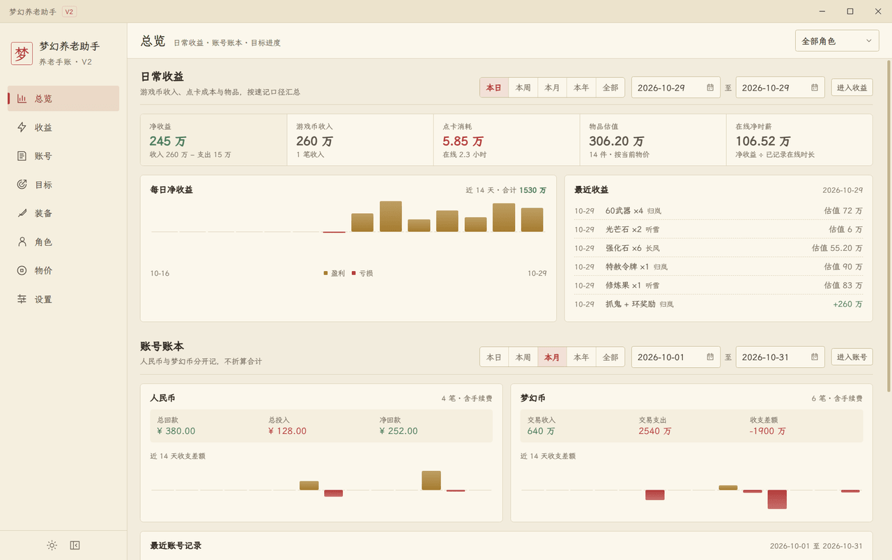
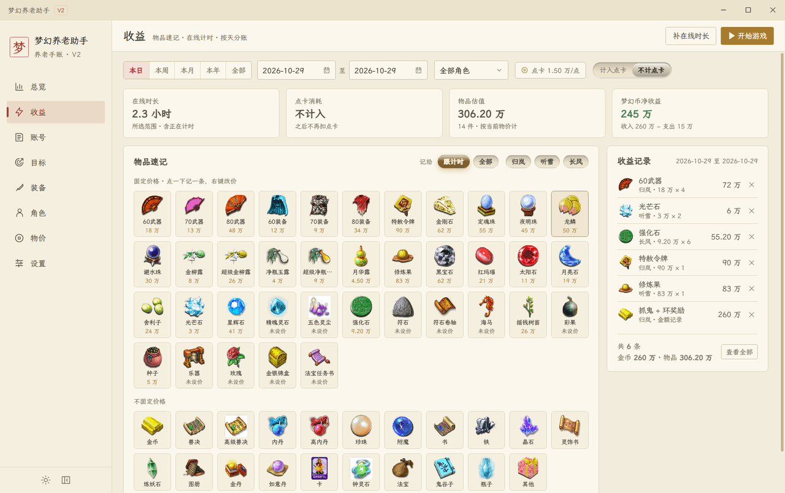
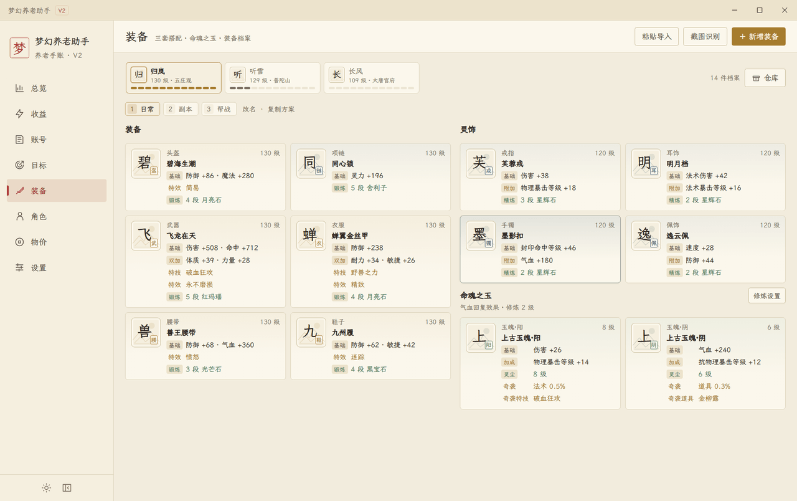
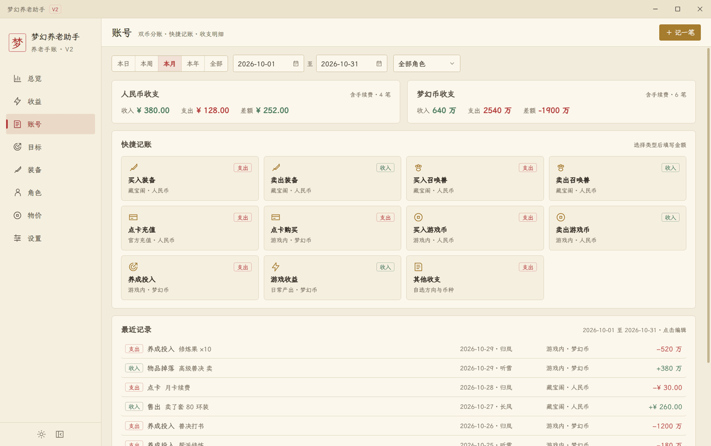
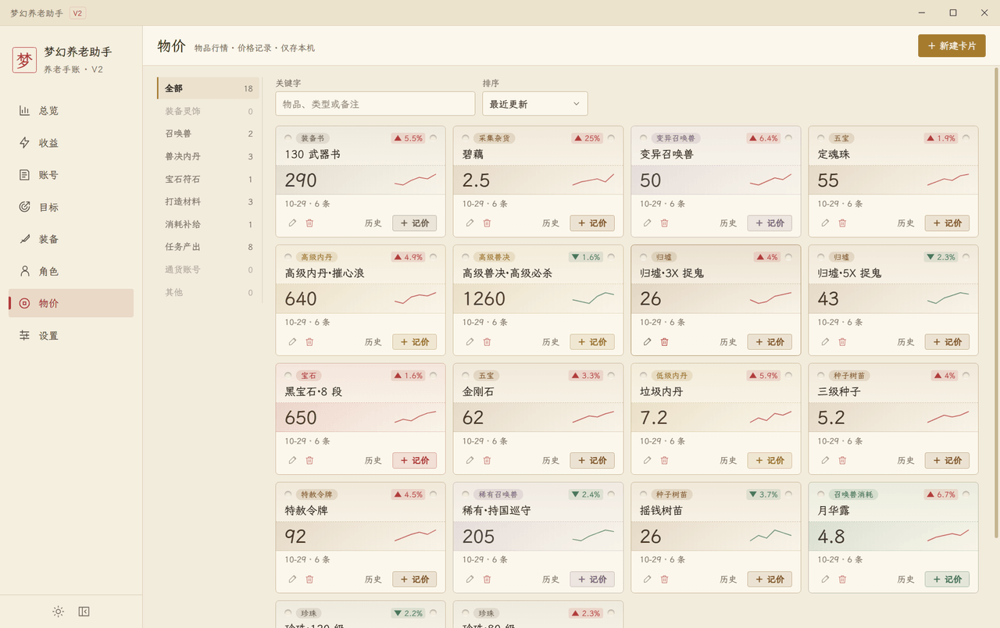
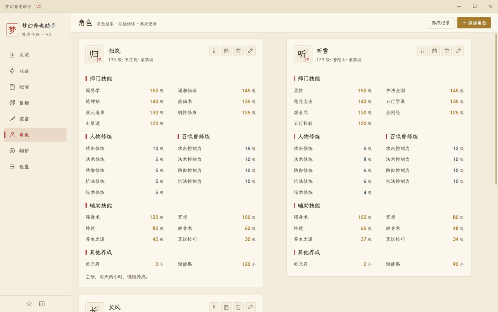
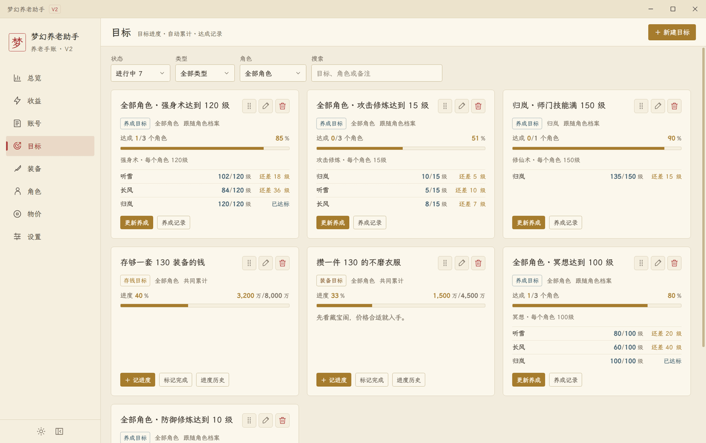
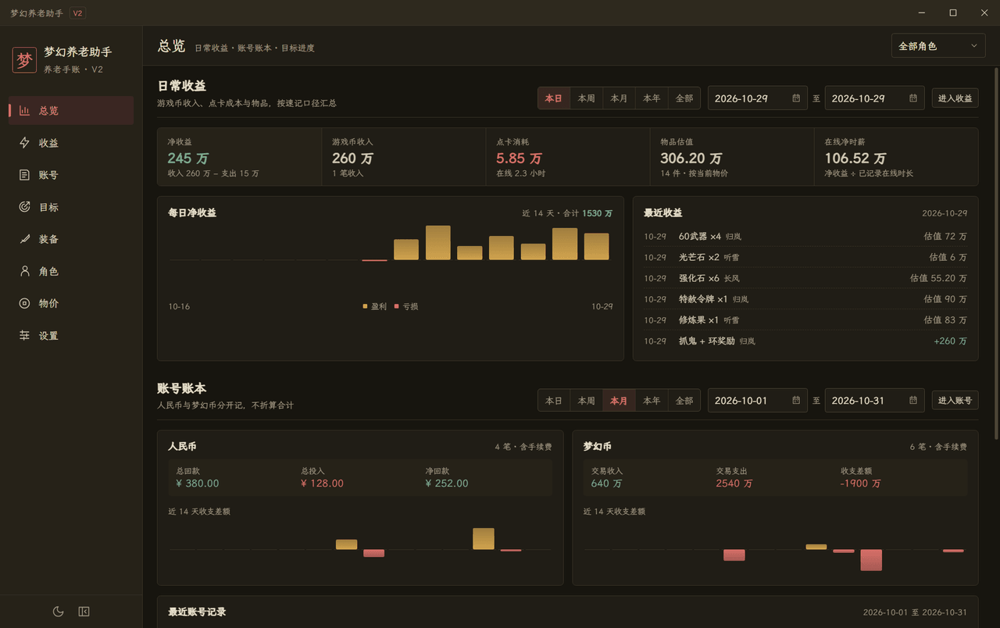

# 梦幻养老助手 V2

梦幻西游的养成与账本手账。**数据只存在本机**：不登录、不上传、断网可用。

Electron 38 + Vue 3 + TypeScript + Pinia，八个页面覆盖从记一笔收益到配一套装备。



## 功能

| 页面     | 用来做什么                                                                         |
| -------- | ---------------------------------------------------------------------------------- |
| **总览** | 收益、账号、目标三块汇总，14 天零轴趋势，最近记录                                  |
| **收益** | 物品速记（点一下记一条，按当前物价估值）、在线计时（多开按人头分摊点卡）、按天分账 |
| **账号** | 人民币与梦幻币分账，快捷记账，全部记录筛选与 CSV 导出                              |
| **目标** | 养成目标跟随档案自动累计；存钱与装备目标手动记进度                                 |
| **装备** | 三套方案、12 个格子（常规 6 + 灵饰 4 + 玉魄 2）、仓库、结构化属性、截图识别        |
| **角色** | 档案、师门与辅助技能、人物与召唤兽修炼、门派模板、转门派                           |
| **物价** | 九个一级分类、三十七个二级，卡片式行情与价格流水                                   |
| **设置** | 三档外观、JSON 备份导入导出、使用帮助、检查更新                                    |

## 截图

<table>
    <tr>
        <td width="50%" align="center"><b>收益 · 物品速记与在线计时</b></td>
        <td width="50%" align="center"><b>装备 · 三套方案与命魂之玉</b></td>
    </tr>
    <tr>
        <td><a href="docs/screenshots/income.png"></a></td>
        <td><a href="docs/screenshots/equipment.png"></a></td>
    </tr>
    <tr>
        <td align="center"><b>账号 · 双币分账与快捷记账</b></td>
        <td align="center"><b>物价 · 两级分类与价格曲线</b></td>
    </tr>
    <tr>
        <td><a href="docs/screenshots/accounts.png"></a></td>
        <td><a href="docs/screenshots/prices.png"></a></td>
    </tr>
    <tr>
        <td align="center"><b>角色 · 技能与修炼</b></td>
        <td align="center"><b>目标 · 自动累计与手动进度</b></td>
    </tr>
    <tr>
        <td><a href="docs/screenshots/characters.png"></a></td>
        <td><a href="docs/screenshots/goals.png"></a></td>
    </tr>
</table>

外观有跟随系统 / 浅色 / 深色三档，随时切换：



## 快速开始

```bash
git clone https://github.com/zhijian521/mh-toolbox.git
cd mh-toolbox
npm ci
npm run dev            # 同时起 Vite 与 Electron，Vue/CSS 热更新
```

需要 Node 22.12 以上（见 `.nvmrc`）。开发服务只监听 `127.0.0.1:5174`，被占用会直接报错。

想直接装来用：到 [Releases](https://github.com/zhijian521/mh-toolbox/releases) 下载安装版或便携版；也可以本地打包：

```bash
npm run dist           # 安装版 + 便携版，输出到 release/
npm run dist:dir       # 只出免安装目录
```

## 数据与升级

- 数据在 `%APPDATA%/mh-tool-v2/data.json`，不在安装目录，**升级不会丢**。
- 安装版直接双击新包覆盖安装，便携版用新 exe 替换旧的，两种装法共用同一份数据。
- 普通保存保留 3 份滚动备份；导入、清空、换版另存事务备份；拒绝用低版本覆盖高版本。
- 设置页可导出 / 导入 JSON 备份，换机器时拷这一份就够。

## 开发

```bash
npm run check          # prettier + eslint + vue-tsc + 领域测试
npm run build          # 生产前端，输出 dist/renderer
npm start              # 需先 build
npm run test:electron  # 需先 build；真实窗口与 IPC，只碰系统临时目录
npm run inspect        # 取景用：合成数据开一个临时 profile
npm run shots          # 重新生成 README 截图，写入 docs/screenshots
```

提交信息前缀限 `feat` / `fix` / `docs` / `style` / `refactor` / `perf` / `test` / `build` / `ci` / `chore` / `revert`，可带 scope，中文描述（`npm run lint:commits` 校验）。

## 文档

- [架构与边界](docs/ARCHITECTURE.md)：目录职责、状态与事务、错误分层、本地 OCR 边界
- [界面与样式规范](docs/UI_GUIDE.md)：视觉基座、焦点与键盘、组件契约
- [配色令牌与暗色模式](docs/THEME.md)：令牌体系、切换机制、对比度红线
- [页面开发指南](docs/PAGE_GUIDE.md)：以角色页为范本的动作清单与反模式
- [验证记录](docs/VALIDATION.md)：每次改动的做法、踩过的坑与验证方式

## 许可

源码公开在 [GitHub](https://github.com/zhijian521/mh-toolbox)，采用 [PolyForm Noncommercial 1.0.0](https://polyformproject.org/licenses/noncommercial/1.0.0)，**不是**可商用的开源许可。

可以运行、复制、修改，个人学习与娱乐使用；不可以打包出售、收费分发或作任何商业用途。早期以 MIT 发布的副本不受影响。

V1 的完整工程已于 2026-10-29 从仓库移除，需要查阅时从 git 历史取：`git ls-tree -r --name-only e51908c:migration/initial-baseline`。
